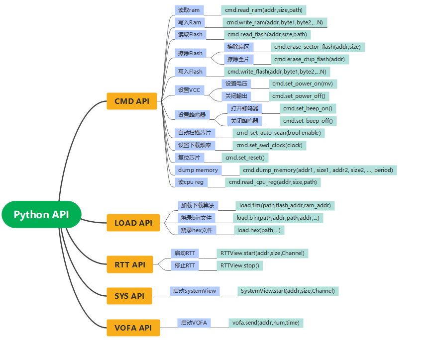

# 下载器内部 Python API

本页是下载器端 PikaPython 接口速查，用于脱机脚本、设备控制和旧串口工作流；
它不同于电脑端 `mklink` Python 包、CLI、MCP 和 Web API。


<a id="pcai"></a>

## 接入方式与版本

- GUI、CLI、MCP 通过同一共享后台使用下载器；自定义脚本不能另开它已占用的命令口。
- 现代在线内存、RTT、SystemView 和 SuperWatch 由上位机管理 [MUX 会话](mux-protocol.md)。
  能力以 `cmd.get_version()` 的 `MUX_TARGET=1` 和 HELLO 回应为准，不只适用于 V4。
- MUX 模式不能混发 Pika 文本。烧录、设备设置等文本操作由共享后台协调，先停止相关采集。
- 写入前确认地址、目标和影响；超时后先核对结果，不自动重发写入、复位或烧录。

核对基线：2026-11-07，正式上位机 [v0.4.2](https://github.com/MicroKeen/Mklink-AI-Probe/releases/tag/v0.4.2)；
[固件目录](https://github.com/MicroKeen/Mklink-AI-Probe/blob/186b6a0ffa2408d48b8c558eb01782fae84e96bc/Mklink-AI-Probe/mklink/firmware-catalog.json)
为 MicroLink V2.9.3 / V3.6.8 / V4.7.2、HPMLink V4.7.2。
下文标注“开发版”的接口来自 0.4.3 main 调用契约，须另查设备能力；不能仅凭相同版本号判断支持。
本次核对上位机源码与固件发布目录，未取得最新固件 `.pyi` / C 源码，也未重新实测硬件。

## 1. cmd：内存与设备控制

<a id="1cmd-api"></a>
<a id="11-ram"></a>
<a id="13-flash"></a>
<a id="16-cpu-reg"></a>

### 读取内存

| 接口 | 参数与用途 |
| --- | --- |
| `cmd.read_ram(addr, size[, path])` | 从目标地址读取 `size` 字节；省略路径时输出文本 |
| `cmd.read_flash(addr, size[, path])` | 读取映射的 Flash；读取本身不需要 FLM |
| `cmd.read_cpu_reg(addr, size[, path])` | **按地址读取内存**，不是读取 R0/PC 等 CPU 核心寄存器 |

`path` 保存到下载器文件系统，旧固件需重启下载器后 U 盘才显示新文件。
直接文本检查控制在 1～4096B；在线大块读取交给 MUX 分块，不用循环 hexdump 代替采样。

```python
cmd.read_ram(0x20000000, 32)
cmd.read_flash(0x08000000, 128, "flash.bin")
```

<a id="12-ram"></a>
<a id="18-flush"></a>

### 写入 RAM

| 接口 | 用途 |
| --- | --- |
| `cmd.write_ram(addr, b0, b1, ...)` | 少量字节写入，字节范围 0～255 |
| `cmd.flush_memory(addr, b0, b1, ...)` | 同上 |
| `cmd.flush_memory((addr, data))` | 连续数据，`data` 为 bytes、bytearray、整型 list/tuple |
| `cmd.flush_memory([(addr1, data1), ...])` | 按顺序写入多个区域，不是原子事务 |

```python
cmd.write_ram(0x20001000, 0xA5, 0x5A)
cmd.flush_memory((0x20002000, bytes([0x5A]) * 128))
cmd.read_ram(0x20002000, 128)
```

只写确认可用的 RAM，不覆盖栈、堆或 DMA 缓冲。命令回显、`>>>` 或低层 ACK
不代表数据已验证，写后应回读比对。旧文本接口的历史边界为散参 20B、多地址 8 项、
单地址实测 16300B，多地址总量参考该边界；不是所有固件的保证，也不能代替 MUX 的协商限制。

<a id="14-flash"></a>
<a id="15-flash"></a>

### 擦写 Flash（Arm）

| 接口 | 用途 |
| --- | --- |
| `cmd.erase_sector_flash(addr)` | 擦除 `addr` 对应扇区，地址须对齐 |
| `cmd.erase_chip_flash(addr)` | 整片擦除；`addr` 为目标 Flash 基址 |
| `cmd.write_flash(addr, b0, b1, ...)` | 写入字节 |

先用 `load.flm()` 加载匹配算法，核对擦除范围和需保留数据。HPM 改用下文 ROM API。

<a id="17-dump"></a>

### 采样

当前开发版在线采样仅使用 [MUX Watch / Bulk](mux-protocol.md#5-watch)，不再发送
`cmd.dump_memory`。旧 Pika 参数和 `MPMDMPMD` 帧见[历史协议](../legacy/dump-memory-protocol.md)。
历史 `SW01` / `MPMDMPMD` 文件解码仍保留，不能作为在线失败后的降级路径。

<a id="19"></a>
<a id="110"></a>
<a id="111-vrefv4"></a>
<a id="112-vccv3v4"></a>
<a id="113-v3v4"></a>
<a id="114-v4"></a>

### 设备控制与诊断

| 接口 | 参数 / 结果 |
| --- | --- |
| `cmd.get_version()` | 固件身份与能力声明；用于 MUX、JTAG 等能力检查 |
| `cmd.get_idcode()` | 缓存的目标 ID，不证明当前在线或精确 MCU 型号 |
| `cmd.read_swd_idcode()` | 实时 SWD 存在性；0 / `0xFFFFFFFF` 表示无目标，负值表示未知/错误 |
| `cmd.get_memory(index)` | `-1` 探针堆，`-2` 探针复位诊断，其余为探针线程栈；不是目标 RAM |
| `cmd.set_reset()` | 目标复位；不等于重启下载器，按目标架构由上位机路由 |
| `cmd.set_swd_clock(clock)` | 调试时钟 Hz；HPM JTAG 只能选固件声明档位，不按任意 SWD 频率设置 |
| `cmd.set_auto_scan(enable)` | 自动扫描开关，返回所请求的布尔整数 |
| `cmd.set_auto_follow_vref(enable)` | V4 电平跟随，返回所请求的布尔整数 |
| `cmd.set_power_on(mv)` / `cmd.set_power_off()` | V3/V4 供电控制；当前上位机开放 1800 / 3300 / 5000 mV，成功返回 0 |
| `cmd.set_beep_on()` / `cmd.set_beep_off()` | V4 蜂鸣器开关，成功返回 0 |

VREF 是输入，VCC 是输出。改变电压前确认目标允许范围和外部供电关系；ACK 不代表实测电压。
当前上位机因缺少电压回读契约不开放自动 VREF 跟随的开启操作。蜂鸣器开启后须关闭。
HPM 实时检测使用 `hpm.jtag_presence_supported()` / `hpm.read_idcode()`，不套用 SWD 检测。

## 2. load：Arm 脱机烧录

<a id="2-load-api"></a>
<a id="21"></a>
<a id="22-bin"></a>
<a id="23-hex"></a>

| 接口 | 参数 |
| --- | --- |
| `load.flm(path, flash_addr, ram_addr)` | 算法文件、Flash 基址、算法运行 RAM 基址 |
| `load.bin(path, addr, ...)` | 一个或多个 BIN 文件与下载基址对 |
| `load.hex(path, ...)` | 一个或多个 Intel HEX 文件，使用文件内地址 |

```python
if load.flm("FLM/STM32F10x_1024.FLM", 0x08000000, 0x20000000) == 0:
    load.bin("bootloader.bin", 0x08000000, "app.bin", 0x08005000)
# HEX 任务改用 load.hex("app.hex")
```

地址只作示例，应匹配工程和目标算法；多镜像按顺序执行，任一步失败就停止后续操作。

## 3. hpm：ROM 烧录与 CPU 调试

HPM 使用具备相应能力的 V4 / HPMLink，不加载 Cortex-M FLM。

| 接口 | 参数与用途 |
| --- | --- |
| `hpm.board(name)` | 选择明确的板卡配置，例如 `"hpm5301evklite"` |
| `hpm.flash_cfg(word0, word1, word2, word3)` | 无匹配板型时提供实际 NOR 的四字配置 |
| `hpm.program(path, addr)` | BIN 文件与基址 |
| `hpm.program_hex(path)` | Intel HEX 文件，使用文件内地址；须支持该接口 |

```python
if hpm.board("hpm5301evklite") == 0:
    hpm.program("demo.bin", 0x80000400)
```

核对具体芯片、板卡、Flash 参数及镜像范围。ROM 烧录可能复位并运行目标，不能据上位机
`reset_after=false` 推断禁止内部复位。需检查每个文件的完整烧录结果，单个整数 0 不足以证明成功。

### HPM_DEBUG v1（按能力启用）

先确认 `hpm.debug_version()` 返回 1，再读 `hpm.debug(0)` 的能力位；停止采集后使用。

| 接口 | 功能 |
| --- | --- |
| `hpm.debug(0)` / `hpm.debug(1)` | 能力 / 实时状态 |
| `hpm.debug(2, timeout_ms)` | 暂停 |
| `hpm.debug(3, timeout_ms)` / `hpm.debug(4, timeout_ms)` | 继续 / 单步；超时范围 1～1000 ms |
| `hpm.debug(5, kind, number)` | 读寄存器：kind=0 为 x0～x31 / PC=32，kind=1 为支持的 CSR 编号 |
| `hpm.debug(6, 0, number, value)` | 写 x1～x31 或 PC；不写 x0 / CSR，PC 须 2 字节对齐 |
| `hpm.debug(7, slot)` | 查询硬件断点 |
| `hpm.debug(8, slot, address)` / `hpm.debug(9, slot, address)` | 设置 / 清除断点；地址须 2 字节对齐，slot 不超过能力声明 |

结果为 `HPM_DEBUG {...}` JSON：核对 `v=1`、操作码、`xlen=32`、`hart=0`、`rc=0`、
`cleanup=0`；`state` 1=运行、2=暂停、0=其他。单步、寄存器及断点访问须 hart 已暂停，接口不代为暂停。
回执缺失，或失败记录中 `issued=1`、`cleanup!=0`、`rc=-9` 表示结果不确定时，不重放操作。
`issued=1` 本身只表示操作已发出，不表示失败；不改走 ARM 接口。

### UART ROM ISP 与 OTP

`hpm.isp_supported()` 检查 ISP 能力。脱机生成器调用
`hpm.isp_config(baud, connect_ms, command_ms, config_addr, memory_id, flash_base, flash_size, sector_size, option0, option1, option2, option3[, beep_ms])`，
再调用 `hpm.isp_program(job_id, count, beep, reset, restore_mv, power_off_ms, path, addr, ...)`。
`reset`：0=不复位，1=软件复位，3=电源循环；不要把 2（RST）当作电源循环。

这些参数由[上位机 ISP 生成器](https://github.com/MicroKeen/Mklink-AI-Probe/blob/186b6a0ffa2408d48b8c558eb01782fae84e96bc/Mklink-AI-Probe/mklink/hpm_isp.py)按实际工程生成。
ISP 是独立 ROM 启动方式，不在 JTAG 失败后自动切换。OTP 写入与锁定不可逆，使用
[受控 OTP 流程](../hpm/gui-otp.md)核对身份、预期值和确认，不直接复制原始写命令。

## 4. 传统 RTT、SystemView 与 VOFA+

<a id="3-segger-rtt-api"></a>
<a id="31-rtt"></a>
<a id="32-rtt"></a>
<a id="4-segger-systemview-api"></a>
<a id="41-systemview"></a>
<a id="4-vofa-api"></a>
<a id="41-vofa"></a>

| 接口 | 参数 |
| --- | --- |
| `RTTView.start(addr, size, channel)` | RTT 控制块搜索起点、范围、通道 |
| `RTTView.stop()` | 停止传统 RTT 映射 |
| `SystemView.start(addr, size, channel)` | 同上，选目标已配置的 SystemView 通道 |
| `vofa.send(addr, num, period)` | 连续变量起点、数量、周期（秒）；period=0 停止 |

直接调用这些传统串口流时，先释放共享后台。现代 GUI / MCP / CLI 的 RTT 与
SystemView 使用 MUX 的共享 RTT 控制块和独立消费者，VOFA 使用共享采集入口，均不另开 CDC。
RTT 通道以目标实际初始化为准。

## 5. serial：UART / RS485（V4）

<a id="5-apiv4"></a>
<a id="51-uart"></a>
<a id="52-rs485"></a>

| 接口 | 用途 |
| --- | --- |
| `serial.uart(baud)` / `serial.rs485(baud)` | 创建 UART / RS485 对象 |
| `port.write_bytes(data, length)` | 发送 bytes；字符串先 encode，返回底层发送结果 |
| `port.read_bytes(length)` | 返回当前队列中最多 length 字节的 bytes，可能为空 |

```python
import serial
uart = serial.uart(115200)
data = "status\r\n".encode()
uart.write_bytes(data, len(data))
received = uart.read_bytes(128)
```

RS485 只需替换创建对象一行；仅在协议确认为文本时 decode。



参考：[PikaPython](https://pikapython.com/doc/#pikapython)、
[当前主机命令契约](https://github.com/MicroKeen/Mklink-AI-Probe/blob/186b6a0ffa2408d48b8c558eb01782fae84e96bc/Mklink-AI-Probe/mklink/probe_commands.py)、
[MUX 协议](mux-protocol.md)、[共享工作流](v4-shared-cdc.md)。
